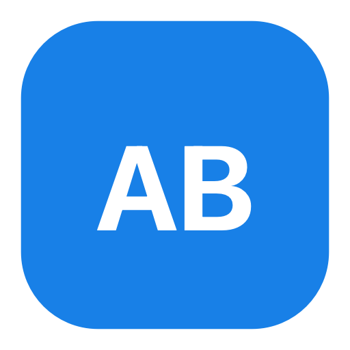

# AppMeta Build

**macOS app for Xcode Archive → manually signed IPA export → App Store Connect upload.**

Independent tool. It does **not** depend on [appmeta-local](https://github.com/dotcn999/appmeta-local).

[Website](https://appmeta-build.findo.workers.dev) · [Download](https://github.com/dotcn999/appmeta-build/releases/latest) · [Issues](https://github.com/dotcn999/appmeta-build/issues)

中文：本机完成 Archive、手动签名导出 IPA、上传 App Store Connect。API 密钥只保存在这台 Mac 的钥匙串里。



## Features

- **Archive → Export → Upload** in one flow, or run each step alone
- **Manual signing** with installed provisioning profiles and keychain certificates
- **App Store Connect API** via Key ID, Issuer ID, and `.p8` (stored in the login / data-protection keychain)
- **Live build log** with stage coloring
- **Chinese / English** UI, light / dark appearance

## Install

1. Download `AppMeta-Build.zip` from the [latest release](https://github.com/dotcn999/appmeta-build/releases/latest).
2. Unzip to get `AppMeta Build.app`.
3. If Gatekeeper blocks it: right-click the app → **Open**.

Requires a Mac with **Xcode** installed (the app shells out to `xcodebuild` / Transporter).

## Usage

1. Enter **Key ID** and **Issuer ID**, then choose your AuthKey `.p8`.
2. Select a `.xcodeproj` or `.xcworkspace` and **Inspect**.
3. Pick **Scheme** and **provisioning profile**; confirm certificate readiness.
4. Run **Archive, export & upload**, or export / upload separately.

## Privacy

- Credentials live only on this Mac (`Keychain` + `~/Library/Application Support/AppMeta Build/config.json`).
- The private key is **not** written as a plaintext `.p8` next to the config.
- Nothing in this repository contains your API keys or certificates.

## Build from source

```bash
open AppMetaBuild.xcodeproj
```

1. Select target **AppMetaBuild** → **Signing & Capabilities**.
2. Choose your **Team**. Keep App Sandbox **off** (needed for `xcodebuild` and provisioning profiles).
3. Run the **AppMetaBuild** scheme on **My Mac**.

Release build:

```bash
xcodebuild -project AppMetaBuild.xcodeproj -scheme AppMetaBuild -configuration Release
```

| Item | Where |
| --- | --- |
| Signing Team | Target → Signing & Capabilities |
| Bundle ID | default `io.appmeta.build` |
| App icon | `AppMetaBuild/Assets.xcassets/AppIcon` |
| Version | Target → General (currently `1.1.0`) |

## Website (Cloudflare)

Static site in [`site/`](site/). Deploy:

```bash
npm install
npm run deploy
```

Live: https://appmeta-build.findo.workers.dev

## License

No license file is published yet. All rights reserved by the author unless stated otherwise. Contact the maintainer if you need reuse terms.
